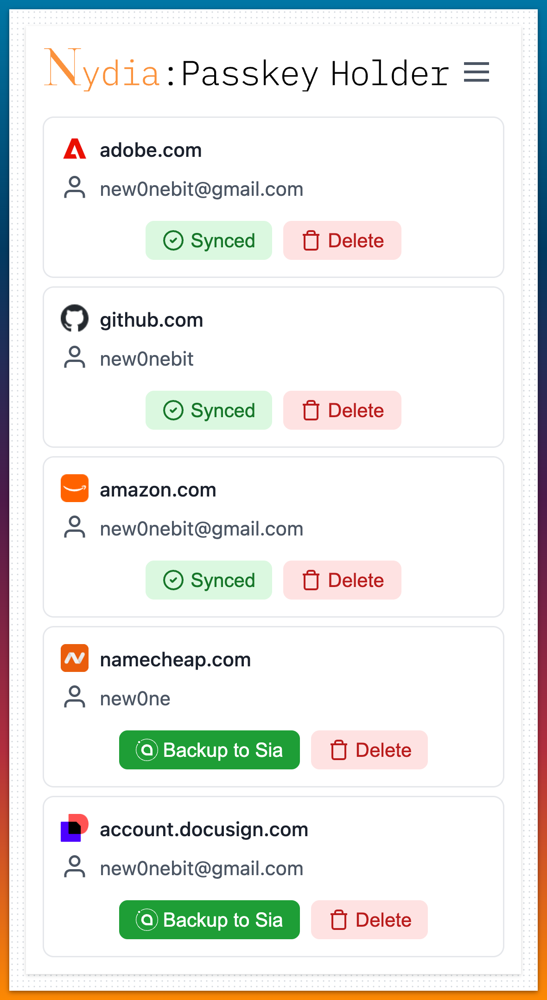
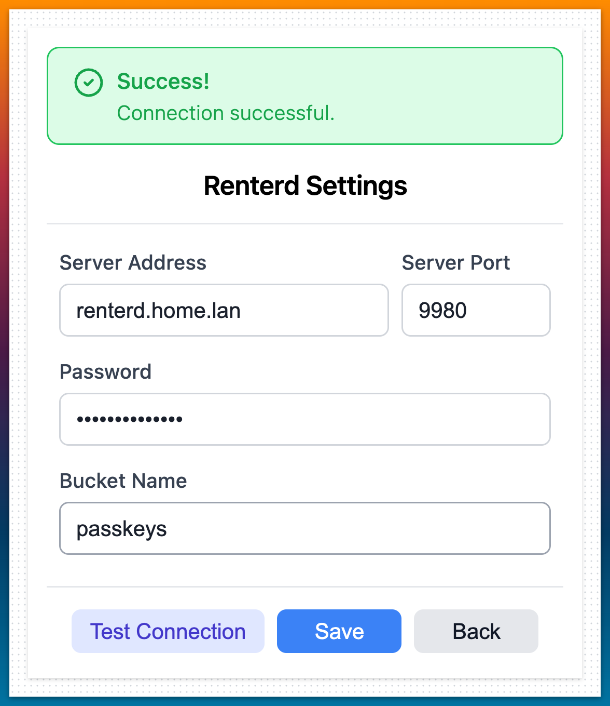

<h1 align="center">
  <picture>
    <source srcset=".docs/images/nydia-leaf-dark.svg" media="(prefers-color-scheme: light)" height="44px" alt="Nydia Logo">
      
  </picture>
</h1>

<p align="center">
  Fast and lightweight browser extension for decentralized passkey storage on the <a href="https://sia.tech">Sia network</a>.
  <br>
  Hold your passkeys locally with encrypted decentralized backup.
  <br>
  One codebase for Chrome, Firefox and Safari.
</p>

<div align="center">

[](https://chrome.google.com/webstore/detail/)
[](https://addons.mozilla.org/firefox/addon/)
[](https://apps.apple.com/app/) <br>
[](https://www.w3.org/TR/webauthn-3/)
[![Passkeys](https://img.shields.io/badge/Authentication-Passkeys-2EA44F?logo=)](https://www.w3.org/TR/webauthn-3/)
[![Sia](https://img.shields.io/badge/Storage-Sia%20Network-00C65E?logo=)](https://sia.tech/)
[](LICENSE)

</div>

<div align="center">
    
</div>
<br>

## Preparing to build

#### Prerequisites
- Node.js 24+ and npm
- Xcode with command-line tools (Safari only)

Safari build runs on Safari 17+ and macOS 12.0+

## How to build Nydia

1. Clone the repository:
```bash
git clone https://github.com/new0nebit/Nydia-Passkey-Holder.git
cd Nydia-Passkey-Holder
```

2. Install dependencies:
```bash
npm install
```

3. Build the extension for the browser you need:
```bash
npm run build            # all browsers
npm run build:chrome     # → build/chrome
npm run build:firefox    # → build/firefox
npm run build:safari     # → build/safari
```

### Chrome

- Navigate to `chrome://extensions`
- Enable "Developer mode"
- Click "Load unpacked" and select the `build/chrome` directory

### Firefox

- Navigate to `about:debugging#/runtime/this-firefox`
- Click "Load Temporary Add-on"
- Select any file from the `build/firefox` directory

### Safari

1. Build the app:
```bash
xcodebuild \
  -project "app/Nydia Passkey Holder.xcodeproj" \
  -scheme "Nydia Passkey Holder" \
  -configuration Release \
  -derivedDataPath build/xcode \
  DEVELOPMENT_TEAM=
```

2. Launch the app once so Safari registers the extension:
```bash
open "build/xcode/Build/Products/Release/Nydia for Safari.app"
```

3. Enable the extension in Safari:
    - Open Settings
    - Go to `Advanced` and enable "Show features for web developers"
    - Navigate to `Developer`
    - Enable "Allow unsigned extensions"
    - Go to `Extensions` and turn on Nydia: Passkey Holder

## Development

```bash
npm run dev           # rebuild on change
npm run check         # lint + type-check
npm test              # unit and integration tests
npm run debug         # production build that keeps debug logging
npm run analyze       # bundle size report
```

Chrome, Firefox and Safari share one codebase. API adapters live in `src/browser-api/`, browser-specific files in `assets/`, and Safari's native app wrapper in `app/`.

## Sia backup<sup><a href="https://sia.tech"></a></sup>

1. Install and configure `renterd` following the [official documentation](https://docs.sia.tech/renting/setting-up-renterd).
2. In the extension, configure your `renterd` settings:
    - Server Address
    - Server Port
    - Password
    - Bucket Name
3. Click **Save**, allow access to your server if Nydia asks, then click **Test Connection**.

<div align="center">
    
</div>

## Security and privacy

Nydia is local-first: your passkeys are encrypted with keys derived from your recovery phrase.\
No Nydia account is required. No telemetry. No tracking.

- **Encrypted on your device.** Your passkeys, their details, your `renterd` settings, including the server password, and saved website icons are encrypted locally with AES-256-GCM. Backups are encrypted before they leave your device.
- **Recovery phrase.** During setup, Nydia generates a 12-word recovery phrase on your device or lets you enter an existing Nydia phrase. It creates your encryption key from the phrase locally and stores the key, not the phrase itself. Nydia doesn't send your recovery phrase or encryption key outside your device. To restore your passkeys, you need the phrase and access to the same `renterd` server and bucket, so keep it somewhere safe.
- **Network access.** Nydia communicates with websites when you create a passkey or sign in, and with your chosen `renterd` server for backups. Website icons are optional and off by default. If you turn on **Show website icons** in Settings, Nydia downloads missing icons from Google. These requests send the site's domain and your IP address to Google. You can turn icons off there at any time.

Read the [Privacy Policy](PRIVACY.md) for details.

<br>

<div align="center">
  <a href="https://sia.tech"><picture><source
    srcset=".docs/images/built-on-sia-light.svg"
    media="(prefers-color-scheme: dark)"
  ></picture></a>
  &emsp;&emsp;
  <a href="https://sia.tech/grants"><picture><source
    srcset=".docs/images/sia-grant-light.svg"
    media="(prefers-color-scheme: dark)"
  ></picture></a>
</div>
